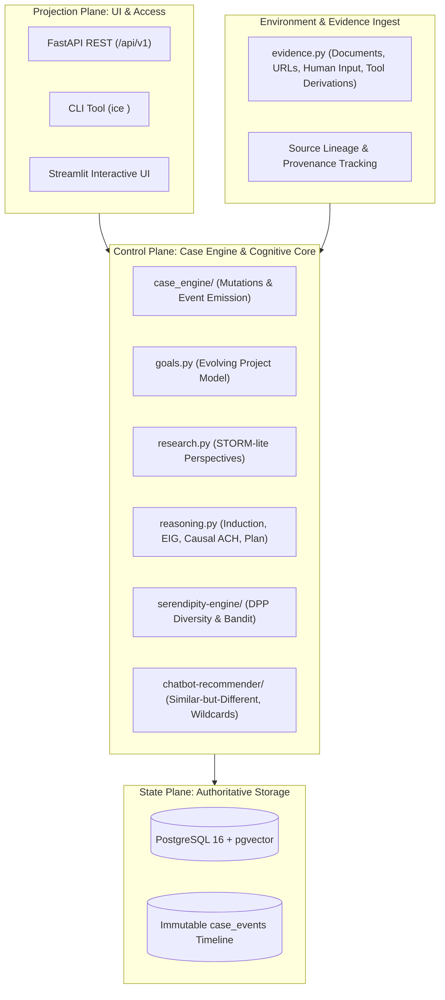

# ICE — Investigation Continuity Engine

[](https://www.python.org/downloads/)
[](#architecture--four-planes)
[](https://fastapi.tiangolo.com)
[](https://github.com/pgvector/pgvector)
[](#license)

**ICE (Investigation Continuity Engine)** is an agentic, persistent cognitive workspace designed to preserve investigative state, evidence, claims, hypotheses, contradictions, decisions, and next-best actions across sessions.

Built from the ground up to prevent AI investigation amnesia and echo-chamber loops, ICE unifies a **PostgreSQL-backed Case Engine**, an **Evolving Project Model (Goals Engine)**, **STORM-lite Research Mode**, a **Native Serendipity Engine (DPP & Bandit)**, and a **Diversity-First Chatbot Recommender**.

---

## Architecture — Four Planes



| Plane | Core Implementation | Architectural Rule |
| :--- | :--- | :--- |
| **State** | PostgreSQL + pgvector (`db/migrations/012a–021`) | **Authoritative**. The `cases` row survives sessions; `case_events` is the immutable timeline. |
| **Control** | `case_engine/` + `engine/` + `psyche/` | **Encapsulated**. All state mutations pass through `case_engine` modules; every mutation emits exactly one event row. |
| **Environment** | `case_engine/evidence.py` | **Boundary Discipline**. Nothing enters state without `ingest_evidence()`. |
| **Projection** | `app/` (FastAPI), `cli/`, `ui/` (Streamlit) | **Stateless**. Never owns truth — reads state from the database or API. |

---

## Unified Feature Highlights

### 1. The Evolving Project Model — Goal System (`case_engine/goals.py`)
* **13 Intent Kinds:** `goal`, `need`, `actor`, `scenario`, `requirement`, `quality_objective`, `constraint`, `assumption`, `decision`, `alternative`, `risk`, `open_question`, `milestone`.
* **Clarity Levels 1–4:** Validates exploratory discussion (Level 1) through defined engineering specifications (Level 4).
* **Epistemic Origin Discipline:** Tracks `developer_statement`, `developer_confirmed`, `ice_inference`, `ice_proposal`, `repo_observation`. Crucially: ICE proposals can only be promoted to confirmed by explicit user decisions.
* **Non-Destructive Supersede Chains:** Goals are never deleted; historical intent chains remain visible and traceable.
* **Maturity Ladder:** 7 evidence-gated stages (`no_candidate` → `scaffolded` → `candidate` → `connected` → `tested` → `verified` → `runtime_observed`).
* **Goal Reconciliation:** Morphologically aware intent-vs-implementation reconciliation (`aligned`, `accidental_divergence`, `intentional_evolution`, `unresolved`).

### 2. STORM-lite Research Mode (`case_engine/research.py`)
* **Perspective Discovery:** Derives orthogonal analytical perspectives from claim types and evidence distribution.
* **Information Gap Generation:** Identifies what existing evidence does not answer, generating structured open questions.
* **Tiered Synthesis Outline:** Segregates findings into `established` (verified facts), `contested` (active contradictions), and `interpreted` (model inferences).
* **One-Call Research Brief:** Compiles perspectives, open gaps, and tiered synthesis into a structured brief.

### 3. Native Serendipity Engine (`ice/serendipity-engine/`)
* **Zero Heavy Dependencies:** Standard-library + NumPy/SciPy core.
* **DPP Diversity Kernel:** Determinantal Point Processes for diverse candidate selection.
* **Contextual Multi-Armed Bandit:** LinUCB and Thompson Sampling online learning.
* **Random Walk with Restart (RWR):** Graph exploration over concept taxonomy.
* **ICE Curiosity Bridge:** Non-invasive adapter (`IceSerendipityAdapter`) converting live graph nodes, goals, and research questions into serendipitous suggestions.

### 4. Diversity-First Chatbot Recommender (`chatbot-recommender/`)
* **Mechanism 1 (Similar-but-Different):** Graph-hop retrieval + Maximal Marginal Relevance (MMR) diversification.
* **Mechanism 2 (Wildcards):** Contextual bandit routing across 4 discovery pools (`long_tail_old`, `unknown_author`, `orthogonal_topic`, `pure_random`).
* **Mechanism 3 (Anti-Repetition):** Hard seen-set memory + semantic refractory cosine decay window.
* **Self-Healing Engine Architecture:** Seamless auto-detection and fallback between Qdrant/NumPy and Mab2Rec/Epsilon-Greedy.

---

## Repository Layout

```
├── ice/                                 # Main Investigation Continuity Engine
│   ├── app/                             # FastAPI projection plane (/api/v1)
│   │   ├── routes/                      # Route handlers (cases, goals, actions, etc.)
│   │   └── main.py                      # Application entrypoint
│   ├── case_engine/                     # Core business logic & state mutation plane
│   │   ├── goals.py                     # Evolving Project Model
│   │   ├── research.py                  # STORM-lite research mode
│   │   ├── action.py                    # Action execution lifecycle (10 executors)
│   │   ├── induction.py                 # Hypothesis induction & tournament
│   │   ├── causal.py                    # Causal DAG, ACH matrix & interventions
│   │   ├── retrieval.py                 # Hybrid vector + lexical FTS retrieval
│   │   └── timeline.py                  # Temporal event reconstruction
│   ├── db/migrations/                   # PostgreSQL DDL migrations (012a through 021)
│   ├── serendipity-engine/              # Pure-Python DPP & Bandit diversity engine
│   ├── cli/cli.py                       # Unified CLI tool
│   ├── benchmark/                       # Leak-free offline benchmark runner & cases
│   └── tests/                           # Unit, integration, and evaluation suites
├── chatbot-recommender/                 # Standalone diversity recommender service
│   └── recommender/                     # Catalog, mixer, mechanisms, and demo
├── scripts/                             # Embedded verification & test automation scripts
├── GAP-ACCOUNTING.md                    # Detailed audit against specification
├── SELF-EVALUATION.md                   # Critical self-review & verification report
└── worklog.md                           # Implementation logs & historical evolution
```

---

## Quickstart

### 1. Main ICE Application

```bash
cd ice
python -m venv .venv
source .venv/bin/activate  # On Windows: .venv\Scripts\Activate.ps1
pip install -e ".[dev]"
cp .env.example .env
```

Start the API service:
```bash
uvicorn app.main:app --reload --port 8000
```

Interactive Streamlit UI:
```bash
streamlit run ui/streamlit_app.py
```

### 2. Unified CLI

```bash
# Manage cases
python ice/cli/cli.py case create "Database Latency Spike" "Identify root cause of p99 latency regression"
python ice/cli/cli.py case list

# Evolving Project Model (Goals)
python ice/cli/cli.py goals add <case_id> "Maintain p99 latency under 200ms" --kind need --clarity 3
python ice/cli/cli.py goals list <case_id>
python ice/cli/cli.py goals reconcile <case_id>
python ice/cli/cli.py goals intent-profile <case_id>

# STORM-lite Research Mode
python ice/cli/cli.py research perspectives <case_id>
python ice/cli/cli.py research questions <case_id>
python ice/cli/cli.py research brief <case_id>
```

### 3. Diversity Chatbot Recommender Demo

```bash
cd chatbot-recommender/recommender
python demo.py
```

### 4. Model Context Protocol (MCP) Server (Claude Code, Cursor, Windsurf)

ICE provides a 46-tool Model Context Protocol server exposing case management, inductive hypotheses, ACH matrix evaluation, Evolving Project Model (goals), and codebase grounding over `stdio`.

Run standalone:
```bash
cd ice
python -m app.mcp.server
```

Connect in Claude Code (`~/.config/claude/mcp.json`) or Cursor (`mcp.json`):
```json
{
  "mcpServers": {
    "ice": {
      "command": "python",
      "args": ["-m", "app.mcp.server"],
      "cwd": "C:/dev/HARI ICE VERSIONS/hari ice by z.ai/ICE-improved/ice",
      "env": {
        "REPOINTEL_URL": "http://localhost:8000"
      }
    }
  }
}
```

---

## Verification & Testing

ICE contains automated test suites across all layers:

```bash
# 1. Serendipity Engine unit tests (37 tests, ~1.1s)
python -m unittest discover -s ice/serendipity-engine/tests

# 2. Chatbot Recommender test suite (45 tests)
cd chatbot-recommender/recommender && pytest

# 3. Main ICE unit tests
cd ice && pytest tests/unit

# 4. End-to-end API smoke test (exercising all 13 route modules including goals & research)
python scripts/api_smoke.py
```

---

## License

This project is maintained for investigation continuity research.
